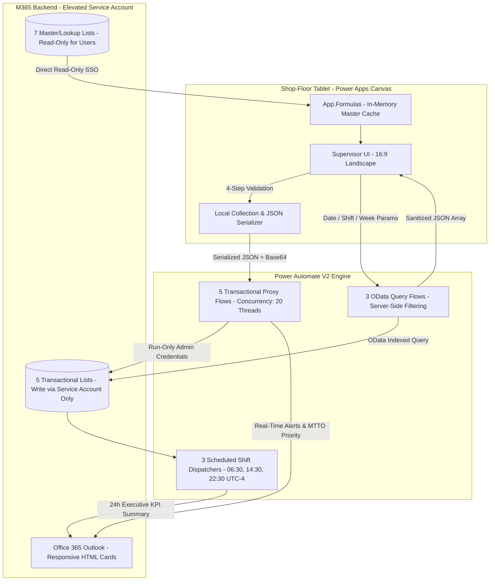

# 🏭 Shop-Floor Manufacturing Execution & Shift Reporting System (MES Lite)


> **Disclaimer & Confidentiality Notice:** *This repository contains the sanitized Solution & Technical Design Documentation (SDD/TDD) of an enterprise low-code application deployed in a multi-line food manufacturing facility. All company trademarks, internal tenant URLs, Active Directory groups, service accounts, and proprietary product recipes have been abstracted to comply with corporate intellectual property and data protection policies.*

---

## 📖 Table of Contents
1. [Business Problem & Solution Overview](#-1-business-problem--solution-overview)
2. [System Architecture & Proxy Security Pattern](#-2-system-architecture--proxy-security-pattern)
3. [Application Design (Screens & Modules)](#-3-application-design-screens--modules)
4. [Data Model & SharePoint Repository Schema](#-4-data-model--sharepoint-repository-schema)
5. [Cloud Flows Register (11 Power Automate Flows)](#-5-cloud-flows-register-11-power-automate-flows)
6. [Core Business Logic & Power Fx Patterns](#-6-core-business-logic--power-fx-patterns)
7. [Role-Based Access Control (RBAC) Matrix](#-7-role-based-access-control-rbac-matrix)
8. [ALM, Environment Variables & Performance](#-8-alm-environment-variables--performance)
9. [Error Handling & Risks Mitigation](#-9-error-handling--risks-mitigation)

---

## 🎯 1. Business Problem & Solution Overview

### The "As-Is" Challenge
Prior to this implementation, shop-floor operational data across 5 continuous biscuit manufacturing lines (Production outputs, Line Downtimes, Material Scrap/Waste, and Mixing Process Parameters) was recorded on physical paper logs and transcribed into multiple unlinked Excel workbooks. This caused:
* **40 to 60 minutes of manual effort** per shift handover to reconcile mass balances.
* **High risk of data tampering**, accidental formula overwrites, and lack of audit traceability.
* **Delayed KPI consolidation** (Yield %, Operational Efficiency % GE) seen hours or days later.
* **Non-standardized downtime categorization** across different shift supervisors.

### The "To-Be" Solution
A unified **Power Apps Canvas application (16:9 Tablet/Desktop)** paired with **11 Power Automate cloud flows** and **12 SharePoint Online lists** operating entirely under **Standard Office 365 seeded licensing** (eliminating premium Dataverse licensing costs for ~50 plant users).

---

## 🏗️ 2. System Architecture & Proxy Security Pattern

Because standard SharePoint permissions do not prevent a user with "Contribute/Edit" rights from bypassing the Power App and modifying records directly via the SharePoint browser UI, a **Zero-Trust Decoupled Proxy Architecture** was engineered:



---

## 📱 3. Application Design (Screens & Modules)

The Canvas App is structured into specialized operational and analytical screens:

| Screen Name | Module Purpose & Technical Functionality |
| :--- | :--- |
| **`Pantalla_Carga`** | **Splash & Auth Router:** 2000ms timer cross-validating O365 User Profile (`User().Email`) against the `Users_Plants` RBAC whitelist and routing by plant location. |
| **`Main_Menu_Hub`** | **Operations Hub:** Central dashboard providing one-click navigation to all operational capture modules, analytical views, and helpdesk ticketing. |
| **`Fail_Screen`** | **Unauthorized Fallback:** Security screen displayed to users missing Active Directory group membership or plant whitelist authorization. |
| **`RPROD_Form`** | **Production Report Form:** Captures shift outputs, packed commercial boxes, dough/cream consumption, and calculates preliminary `YIELD %` and `GE %`. Dynamically renders 4 sub-packaging split inputs when **Composite Line 06** is selected. |
| **`RPERD_Form`** | **Material Losses & Scrap Form:** Cascading dropdowns (Line Zone -> Equipment Tag -> Loss Category -> Root Cause) to log Raw Material, WIP, and Finished Good scrap in kilograms. |
| **`RPARA_Form`** | **Line Downtime Tracking Form:** Logs planned/unplanned stoppages across **13 standard OEE/TPM categories**. Includes a conditional toggle (`ReporteMTTO = "Si Aplica"`) to dispatch high-priority alerts to Maintenance Engineers. |
| **`RPROC_Form`** | **Process Parameters Form:** Specialized chemical/formulation log for Doughs and Creams (`Reporte de Masas` vs `Cremas`), tracking batch weights, flour silos, lot numbers, mixer temperatures (°C), batch serials, and rework (`RWK`). |
| **`RINFO_Form`** | **Executive Shift Inquiry & Master Plan:** On-demand analytical module. Invokes backend OData flows to display Shift Production Summaries, Raw Material Consumptions (Dough, Cream, Oil, Salt, Coatings), and **Weekly Master Plan vs. Actuals** without hitting SharePoint delegation limits. |
| **`SPTCK_Form`** | **Support & Audit Ticketing:** Allows supervisors to report app bugs or request audited modifications/deletions of previously submitted shift records, attaching camera/gallery screenshots converted to Base64. |

---

## 🗄️ 4. Data Model & SharePoint Repository Schema

All lists utilize **Indexed Columns (`Fecha`, `Turno`, `Linea`)** to prevent SharePoint's 5,000-item view threshold bottlenecks. End users have **Read-Only** permissions; all writes are executed by the Service Account.

### 4.1 Transactional Lists (5 Core Lists)

<details>
<summary><b>1. Reportes_Produccion (Shift Production Outputs) - Click to expand</b></summary>

| Column | Type | Permission | Description |
| :--- | :--- | :--- | :--- |
| `ReportID` | Single line of text | System | Primary ID formatted by flow (`RDPRO-YY00000`). |
| `SupervisorMail` / `Name` | Single line of text | System | Submitting supervisor's O365 profile. |
| `Fecha` / `Semana` / `Periodo` | Text / Date | Read-only / System | Shift date (`yyyy-MM-dd`), calculated operational week (`W01`) and period (`P01`). |
| `Turno` / `Linea` | Single line of text | Read-only | Shift (`Turno 1, 2, 3`) and Manufacturing Line (`Linea 02, 04, 06, 09, 10`). |
| `Variedad` / `Presentacion` | Single line of text | Read-only | Product SKU variety and packaging format. |
| `Factor` | Single line of text | System | Packaging sub-factor (`PT1`, `PT2-1`, `PT2-2`, `PT3`, or `NAF`). |
| `Masas` / `Cremas` | Number | Read-only | Dough and Cream mass consumed (kg). |
| `CajasEmpacadas` | Number | Read-only | Total packed commercial boxes. |
| `KGaProducir` / `KGProducidos`| Number | Read-only | Planned target (kg) vs. Actual net volume packed (kg). |
| `YIELD` / `GE` | Number | Read-only | App-calculated preliminary Yield % and Operational Efficiency %. |
| `Comentarios` | Multiple lines | Read-only | Shift handover remarks. |
</details>

<details>
<summary><b>2. Reportes_Perdidas (Material Scrap & Packaging Losses) - Click to expand</b></summary>

| Column | Type | Permission | Description |
| :--- | :--- | :--- | :--- |
| `ReportID` | Single line of text | System | Primary ID (`RDPER-YY00000`). |
| `Fecha` / `Turno` / `Linea` | Text / Date | System | Shift contextual dimensions (Indexed). |
| `Variedad` | Single line of text | Read-only | Product SKU. |
| `Ubicacion` / `Equipo` | Single line of text | Read-only | Line zone and specific machine tag where scrap occurred. |
| `TipoPerdida` / `Perdida` | Single line of text | Read-only | Category (Raw Material, WIP, Finished Good) and specific loss. |
| `Causa` / `Efecto` | Single line of text | Read-only | Root cause breakdown and operational consequence. |
| `Cantidad (Kg)` | Number | Read-only | Total discarded quantity in kilograms. |
</details>

<details>
<summary><b>3. Reportes_Paradas (Line Downtime & OEE Events) - Click to expand</b></summary>

| Column | Type | Permission | Description |
| :--- | :--- | :--- | :--- |
| `Title` | Single line of text | System | Primary ID (`RDPAR-YY00000`). |
| `Fecha` / `Turno` / `Linea` | Text / Date | Read-only | Shift context (Indexed). |
| `Equipo` / `Efecto` | Single line of text | Read-only | Machine causing stoppage and operational classification. |
| `TipoParada` / `SubtipoParada`| Single line of text | Read-only | **13 Official Categories:** `LNO`, `ND`, `FM`, `MP`, `MA`, `SAN`, `CVP`, `PPL`, `RCO`, `IFP`, `GLA`, `FMA`, `PME`, `AVE`, `FOP`, `DLI`. |
| `TiempoMinutos` | Number | Read-only | Total downtime duration in minutes. |
| `LineaParada` | Single line of text | Read-only | Full line stop vs. Equipment stop (`Parada de Linea` / `Equipo`). |
| `ReporteMTTO` | Single line of text | Read-only | Maintenance work order flag (`Si Aplica` / `No Aplica`). |
| `ResponsableMail` / `NumeroReporte` | Single line of text | Read-only | Maintenance engineer email copied on alert and work order # |
</details>

<details>
<summary><b>4. Reportes_Procesos (Batch Mixing & Recipe Parameters) - Click to expand</b></summary>

| Column | Type | Permission | Description |
| :--- | :--- | :--- | :--- |
| `ReporteID` | Single line of text | System | Primary ID (`RDPRC-YY00000`). |
| `TipoReporte` | Single line of text | Read-only | Scope (`Reporte de Masas` vs. `Reporte de Cremas`). |
| `NombreBatch` / `PesoBatch` | Text / Number | Read-only | Formulation identifier and gross batch weight (kg). |
| `Entregadas` / `Recuperadas` / `Dañadas` / `Fabricadas` | Number | Read-only / System | Batch counts delivered, recovered, damaged, and total produced. |
| `RWK de Masa Kg` / `Galleta Kg`| Number | Read-only | Dough rework and crushed biscuit scrap rework added (kg). |
| `Correlativo Inicial` / `Final`| Single line of text | Read-only | Starting and ending batch sequential tracking numbers. |
| `Mezcladora` / `Silo` / `Tipo de Harina` | Single line of text | Read-only | Mixer unit ID, flour storage silo, and specification (`Silos` vs `Sacos`). |
| `Numero de Lote` / `Temperatura`| Text / Number | Read-only | Raw material batch lot number and processing temperature (°C). |
</details>

<details>
<summary><b>5. Tickets_Soporte (In-App Helpdesk & Audit Trail) - Click to expand</b></summary>

| Column | Type | Permission | Description |
| :--- | :--- | :--- | :--- |
| `Title` | Single line of text | System | Sequential Ticket ID (`TKT-YYYYMMDD-HHMMSS`). |
| `TipoSoporte` | Single line of text | Read-only | `Error de Aplicación`, `Modificar Reporte`, `Eliminar Duplicado`, `Consulta`. |
| `TipoReporte` / `FechaOriginal` / `TurnoOriginal` / `LineaOriginal` | Single line of text | Read-only | Audit references to the original shift record requiring correction. |
| `Estatus` | Single line of text | System/Admin | Workflow state (`Pendiente`, `En Revision`, `Resuelto`). |
| `Attachments` | Native SP Binary | System | Screenshots converted from Base64 strings to binary files. |
</details>

### 4.2 Master Data & Lookup Lists (7 Cached Lists)
1. `Users_Plants`: RBAC whitelist matching O365 emails to authorized plant scopes.
2. `MasterData_Lineas`: Active manufacturing lines, speeds, and project mappings.
3. `MasterData_MasasyCremas`: Recipe formulation matrices and standard batch weights.
4. `MasterData_Efectos`: Operational effects and root-cause catalogs.
5. `MasterData_Paradas`: The 13 official downtime categories and subtypes.
6. `MasterData_Perdidas`: Scrap classifications across line stages.
7. `MasterData_LineasZonas`: Hierarchical mapping of Line -> Zone -> Machine Tag (`Equipo`).

---

## ⚡ 5. Cloud Flows Register (11 Power Automate Flows)

All interactive flows use the **PowerApps (V2)** trigger and execute under the elevated Service Account connection.

### 5.1 Interactive Transactional Proxy Flows (5 Flows)
| Flow Name | Input Trigger | Processing & Concurrency Logic | Output & Notifications |
| :--- | :--- | :--- | :--- |
| **`GuardarReporteProduccion`** | `jsonPayload` (String) | Parses JSON array, executes parallel loop (**20 threads**), assigns `RDPRO-` IDs, maps Line 06 splits (`PT1..PT3`). | Writes to `Reportes_Produccion`, emails vertical HTML summary card, returns `exito = True`. |
| **`GuardarReportePerdidas`** | `jsonPayload` (String) | Parses scrap items array, executes concurrent insertion (**20 threads**), calculates total `CantidadKg` KPI banner. | Writes to `Reportes_Perdidas`, dispatches blue-banner HTML scrap card, returns `exito = True`. |
| **`GuardarReporteParadas`** | `jsonPayload` (String) | Deserializes downtime events (**20 threads**); evaluates `ReporteMTTO` flag (`"Si Aplica"` routes high-priority alert to Maintenance; else CCs lead). | Writes to `Reportes_Paradas`, sends conditional maintenance email, returns `exito = True`. |
| **`GuardarReporteProceso`** | `jsonPayload` (String) | Evaluates `TipoReporte` (`Masas` vs `Cremas`), iterates through formulation and rework matrices. | Writes to `Reportes_Procesos`, dispatches technical batch recipe email, returns `exito = True`. |
| **`AbrirTicketSoporte`** | `jsonPayload` (String) | Creates ticket item, iterates through media array converting `base64ToBinary(ContentBytes)` into native SP attachments. | Writes to `Tickets_Soporte`, sends dual emails (User confirmation + Admin alert), returns `exito = True`. |

### 5.2 Interactive Server-Side Query Flows (3 Flows)
| Flow Name | Input Trigger | Processing Logic | Output to Power Apps |
| :--- | :--- | :--- | :--- |
| **`Query-RESUMEN`** | `Fecha`, `Turno` | Queries `Reportes_Produccion` via indexed OData filters and aggregates volume outputs per line. | Returns JSON array to populate `colResumenTurno`. |
| **`Query-CONSUMOS`** | `Fecha`, `Turno` | Extracts and aggregates raw material usage (Dough, Creams, Sandwiches, Coatings, Oil, Salt). | Returns serialized JSON array to `colConsumosTurno`. |
| **`Query-PLAN`** | `Semana` | Queries weekly master schedule list to compare theoretical planned volume vs. actual shift outputs. | Returns weekly plan JSON array to `colPlanSemanal`. |

### 5.3 Automated Shift-End Executive Dispatchers (3 Scheduled Flows)
| Flow Name | Schedule (UTC-4) | Operational Logic & Execution | Target Recipients |
| :--- | :--- | :--- | :--- |
| **`ResumenTurno1`** | Daily at `14:30` | Evaluates completion of Shift 1 (`length(rows) > 0`). Consolidates packed kg, boxes, Yield %, and downtime per line into an executive HTML table. | Plant Operations Management, Shift Leads, and Area Supervisors. |
| **`ResumenTurno2`** | Daily at `22:30` | Evaluates completion of Shift 2. Consolidates evening production, scrap loss metrics, and `% GE` into a responsive HTML card. | Plant Operations Management, Shift Leads, and Area Supervisors. |
| **`ResumenTurno3`** | Daily at `06:30` | Evaluates overnight Shift 3. Applies **date offset logic (`addDays(utcNow(), -1)`)** to close out the previous operational day and compiles 24-hour plant closure KPIs. | Plant Operations Management, Shift Leads, and Area Supervisors. |

---

## 💻 6. Core Business Logic & Power Fx Patterns

### 6.1 Standardized 4-Step Audited Submission Lifecycle
Every transactional form enforces state retention. If a shop-floor WiFi drop occurs, `ResetForm()` is bypassed so the supervisor never loses typed data:

```powerfx
// 1. Flush temporary collection to prevent data bleed
Clear(colRegistrosAReportar);;

// 2. Package local records (applying composite splits & ISO dates)
Collect(colRegistrosAReportar; { ... });;

// 3. Dispatch serialized JSON (including binary data) to elevated Proxy Flow
Set(
    varRespuestaGuardado; 
    'GuardarReporteProduccion'.Run(JSON(colRegistrosAReportar; JSONFormat.IncludeBinaryData))
);;

// 4. Validate audited execution status before resetting UI
If(
    varRespuestaGuardado.exito = "True";
    Notify("Shift report saved successfully."; NotificationType.Success);; 
    ResetForm(frmProduccion);;
    Clear(colRegistrosAReportar);
    // On failure, preserve form state on screen and alert user
    Notify("Submission failed: " & varRespuestaGuardado.error; NotificationType.Error)
);;
```

### 6.2 Composite Line 06 Automatic Volume Splitting
Unlike single-output lines, Line 06 feeds 4 secondary packaging machines from a common dough supply. The app automatically splits a single supervisor submission into 4 transactional records:
* **PT1:** `Round(fxTotalProduccion * 0.10, 2)` (10% mass/volume allocation)
* **PT2-1:** `Round(fxTotalProduccion * 0.25, 2)` (25% mass/volume allocation)
* **PT2-2:** `Round(fxTotalProduccion * 0.25, 2)` (25% mass/volume allocation)
* **PT3:** `Round(fxTotalProduccion * 0.40, 2)` (40% mass/volume allocation)

### 6.3 Base64 Image Extraction for Read-Only Users
To attach screenshots to support tickets without direct SharePoint write permissions, images are serialized in Power Fx and stripped of their data URI header before transmission:

```powerfx
Set(
    varBase64Clean,
    Mid(
        JSON(imgUploadedPhoto.Image, JSONFormat.IncludeBinaryData),
        Find(",", JSON(imgUploadedPhoto.Image, JSONFormat.IncludeBinaryData)) + 1,
        Len(JSON(imgUploadedPhoto.Image, JSONFormat.IncludeBinaryData)) - Find(",", JSON(imgUploadedPhoto.Image, JSONFormat.IncludeBinaryData)) - 1
    )
)
```

### 6.4 Open/Nullable JSON Schema (Regional Decimal Tolerance)
To prevent Power Automate `Parse JSON` failures when tablets are configured in Spanish (`12,50`) vs. English (`12.50`) or when optional fields are left blank, schemas accept polymorphic types:

```json
{
  "type": "array",
  "items": {
    "type": "object",
    "properties": {
      "Masas": { "type": ["string", "number", "integer", "null"] },
      "CajasEmpacadas": { "type": ["string", "number", "integer", "null"] },
      "ReporteMTTO": { "type": ["string", "boolean", "null"] }
    }
  }
}
```

---

## 🔐 7. Role-Based Access Control (RBAC) Matrix

Security is enforced across 3 layers: Corporate AD Security Group -> `Users_Plants` SharePoint Whitelist -> Proxy Service Account.

| Action / Capability | Plant Supervisor / Operator | Operations Management | System Admin / LCNC Lead |
| :--- | :---: | :---: | :---: |
| **Submit Production Report (`RPROD_Form`)** | ✅ | ❌ | ✅ |
| **Submit Scrap / Loss Report (`RPERD_Form`)** | ✅ | ❌ | ✅ |
| **Submit Downtime Report (`RPARA_Form`)** | ✅ | ❌ | ✅ |
| **Submit Process Control Report (`RPROC_Form`)** | ✅ | ❌ | ✅ |
| **Consult Shift KPIs & Weekly Plan (`RINFO_Form`)** | ✅ | ✅ | ✅ |
| **Submit Support / Modification Ticket (`SPTCK_Form`)**| ✅ | ✅ | ✅ |
| **Receive Automated Shift Closure HTML Emails** | ✅ | ✅ | ✅ |
| **View & Resolve All Submitted Support Tickets** | ❌ | ❌ | ✅ |
| **Edit SharePoint Lists Directly via Browser URL** | ❌ *(Read-Only)* | ❌ *(Read-Only)* | ✅ *(Owner)* |

---

## ⚙️ 8. ALM, Environment Variables & Performance

To support seamless Application Lifecycle Management (ALM) across **DEV -> QA -> PROD** managed solutions without modifying hardcoded references, 6 Environment Variables decouple the architecture:

* `Site_RDT_URL`: Target SharePoint Online site URL.
* `List_Produccion_ID` / `List_Perdidas_ID` / `List_Paradas_ID` / `List_Procesos_ID` / `List_Tickets_ID`: Respective SharePoint List GUIDs per environment.

**Session-Level Caching (`App.Formulas`):** All 7 Master Data tables are bound to named formulas at startup, completely eliminating redundant HTTP lookup calls during shift operations and bypassing SharePoint's 2,000-item delegation limit.

---

## 🛡️ 9. Error Handling & Risks Mitigation

| Identified Risk | Severity | Engineering Mitigation Implemented |
| :--- | :---: | :--- |
| **Direct SharePoint Data Tampering** | 🔴 High | **Proxy Security Pattern:** End users have strict Read-Only access; all writes occur via Power Automate `Run-Only` Service Account connections. |
| **SharePoint 5,000-Item View Threshold** | 🟡 Medium | Indexed lookup columns (`Fecha`, `Turno`, `Linea`), strict OData date boundary filters, and annual historical log archiving. |
| **Shop-Floor WiFi Latency / Dropouts** | 🟡 Medium | Local collection buffering + **20-thread parallel loop concurrency** (<2s execution) + Frontend state retention (bypasses `ResetForm` on error). |
| **Middleware Flow Execution Failures** | 🟡 Medium | Power Automate actions are wrapped in **Try-Catch `Scope` containers**. Failures return `exito = False` to the client and alert IT Admins immediately. |
| **Regional Decimal Separator Conflicts** | 🟢 Low | Open-typed JSON schemas (`["string", "number", "null"]`) combined with standardized `Value()` conversions. |

---

## 👨‍💻 Author
**Ing. Tairo Bonilla**  
*Lead Citizen Developer / Power Platform Solutions Architect*  
*Manufacturing & Supply Chain Digital Transformation*
