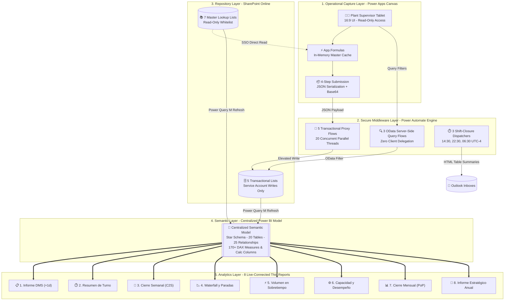

# 🏭 End-to-End Shop-Floor MES & Enterprise Analytics Platform (Power Platform + Power BI)


> **Disclaimer & Confidentiality Notice:** *This repository contains the sanitized Solution & Technical Design Documentation (SDD/TDD), TMDL semantic schema, and architectural patterns of an enterprise Manufacturing Execution System (MES Lite) and Business Intelligence platform deployed in a multi-line food manufacturing facility. All corporate trademarks, internal URLs, tenant GUIDs, and proprietary recipes have been abstracted.*

---

## 📖 Table of Contents
1. [Executive Summary & Problem Statement](#-1-executive-summary--problem-statement)
2. [End-to-End Architecture (Proxy Pattern + Golden Dataset)](#-2-end-to-end-architecture-proxy-pattern--golden-dataset)
3. [Repository Directory Structure](#-3-repository-directory-structure)
4. [Power Platform Operational Capture Layer](#-4-power-platform-operational-capture-layer)
5. [Power BI Centralized Semantic Layer (Golden Dataset)](#-5-power-bi-centralized-semantic-layer-golden-dataset)
6. [Core Business Logic & DAX/Power Fx Patterns](#-6-core-business-logic--daxpower-fx-patterns)
7. [Governance, RBAC & Risk Mitigation](#-7-governance-rbac--risk-mitigation)

---

## 🎯 1. Executive Summary & Problem Statement

Prior to this solution, operational tracking across 5 continuous industrial biscuit production lines was fragmented between physical paper forms and decentralized Excel spreadsheets. This caused:
* **40 to 60 minutes lost per shift** reconciling mass balances and handovers.
* **Severe data tampering risks**, accidental formula overwrites, and audit compliance gaps.
* **Delayed OEE/Yield reporting**, preventing timely operational interventions.

### The Delivered Platform
An integrated, zero-trust solution operating under standard **Office 365 seeded licensing** (zero premium Dataverse costs) that pairs:
1. **A validated Power Apps Canvas frontend (16:9 Landscape)** with 11 high-concurrency Power Automate proxy flows and 12 indexed SharePoint lists.
2. **A centralized Power BI Semantic Model (TMDL / Star Schema)** feeding **8 live-connected analytical thin reports** for Plant Operations, CI, Reliability, and Executive Controllership.

---

## 🏗️ 2. End-to-End Architecture (Proxy Pattern + Golden Dataset)



---

## 📁 3. Repository Directory Structure

```text
📦 powerplatform-manufacturing-mes-architecture
 ┣ 📂 assets
 ┃ ┗ 📜 README.md                      # Mermaid.js architecture, workflows & sequence diagrams
 ┣ 📂 data-model
 ┃ ┗ 📜 sharepoint-lists-schema.md     # Detailed 12-list schema, indexes & field specifications
 ┣ 📂 power-fx-patterns
 ┃ ┣ 📜 01-session-caching-formulas.fx # App.Formulas master table preloading
 ┃ ┣ 📜 02-four-step-json-submit.fx    # 4-step audited submit flow & state retention
 ┃ ┣ 📜 03-composite-line-splitting.fx # Composite Line 06 4-way mass allocation
 ┃ ┗ 📜 04-base64-image-extraction.fx  # Binary camera capture to Base64 extractor
 ┣ 📂 power-automate-schemas
 ┃ ┣ 📜 loose-json-schema.json         # Open, nullable JSON schema (comma/period tolerance)
 ┃ ┗ 📜 odata-aggregation-query.md     # Server-side OData queries & overnight date offset
 ┣ 📂 power-bi-semantic-model
 ┃ ┣ 📂 dax-modules
 ┃ ┃ ┣ 📜 01-dms-daily-management.dax  # DMS offset, yield and shift handover KPIs
 ┃ ┃ ┣ 📜 02-weekly-closure-c2s.dax    # C2S compliance, backlog and WoW metrics
 ┃ ┃ ┣ 📜 03-waterfall-pareto-oee.dax  # 23-step waterfall, invisible base & Pareto
 ┃ ┃ ┗ 📜 04-overtime-capacity-strategic.dax # Overtime ratio, Nexus capacity & PQH axis
 ┃ ┣ 📜 model-schema.tmdl              # Complete Tabular Model Definition Language code
 ┃ ┗ 📜 README.md                      # Star schema, DAX highlights & report matrix
 ┗ 📜 README.md                        # Master project documentation
```

---

## 📱 4. Power Platform Operational Capture Layer

* **Zero-Trust Client Proxy Architecture:** Floor supervisors are assigned strictly **Read-Only** permissions in SharePoint Online. Power Apps bypasses standard direct `Patch()` or `SubmitForm()` commands, instead compiling validated operational data into structured JSON arrays dispatched to elevated Power Automate V2 flows.
* **High Concurrency (< 2s Execution):** All cloud transactional flows utilize **Concurrency Control = ON (20 parallel execution threads)**, driving record persistence down from >30 seconds to under 2 seconds.
* **Automated Composite Line Allocation:** Built-in mass balance splitting for composite lines where a common mixer feeds 4 secondary packaging lines (`10% PT1`, `25% PT2-1`, `25% PT2-2`, `40% PT3`).
* **Base64 Multimedia Pipeline:** Enables tablet camera photo attachments under Read-Only user rights by extracting raw Base64 strings in Power Fx and reconstructing native SharePoint attachments via `base64ToBinary()`.

---

## 📊 5. Power BI Centralized Semantic Layer (Golden Dataset)

The BI tier utilizes Microsoft's recommended **Hub-and-Spoke pattern** with a single centralized semantic model (`RDT_Semantic_Model`) serving 8 live-connected analytical reports:

1. **`Informe DMS`**: Daily Management System tracking yesterday's closure using a `+1 Day` calendar offset (`DiaDMS`).
2. **`Resumen de Turno`**: Operational shift handovers, dough/cream consumption, and preliminary Yield.
3. **`Cierre Semanal`**: Week-over-Week (WoW) volume trends and Full-Outer Bridge `C2S` adherence.
4. **`Waterfall y Paradas`**: 23-step OEE/GE time-loss deconstruction with dynamic 80/20 loss Pareto.
5. **`Volumen en Sobretiempo`**: Regular crewing vs. Overtime classification inferred dynamically from Thursday line activity.
6. **`Capacidad y Desempeño`**: Industrial engineering modeling (`Capacidad Demostrada` vs `Capacidad Efectiva` using `MEDIANX` and `STDEVX.S`).
7. **`Cierre Mensual`**: Period-over-Period (`PoP`) volume and Yield comparisons against quarterly targets.
8. **`Informe Estratégico Anual`**: Multi-horizon financial matrix dynamically displaying `P01..P12`, `Q1..Q4`, `H1..H2`, and `FY`.

---

## ⚙️ 6. Core Business Logic & DAX/Power Fx Patterns

* **State Retention on Failure:** If a shop-floor network disruption occurs, the frontend bypasses `ResetForm()`, retaining all supervisor inputs on the screen for instant resubmission once connectivity restores.
* **23-Step Floating Waterfall Base:** Custom DAX measure (`WF - Base Invisible`) enabling native stacked visual rendering of time deductions across 3 main hierarchical milestones: *Tiempo Máximo* -> *Tiempo Disponible* -> *Tiempo Productivo* -> *Tiempo Operativo* -> *WXFGT*.
* **Look-Behind / Look-Ahead Startup Detection:** Automated calculated columns (`H12` & `H27`) that evaluate chronological adjacent shifts to apply startup and shutdown allowances without manual supervisor tagging.

---

## 🛡️ 7. Governance, RBAC & Risk Mitigation

| Identified Risk | Severity | Engineering Mitigation Implemented |
| :--- | :---: | :--- |
| **SharePoint Direct Tampering** | 🔴 High | **Proxy Security Pattern:** Plant operators hold Read-Only access; all writes execute via Service Account `Run-Only` credentials. |
| **5,000-Item Delegation Limits** | 🟡 Medium | Compound indexed columns (`Fecha`, `Turno`, `Linea`), `App.Formulas` session caching, and server-side OData query flows. |
| **Shop-Floor Network Latency** | 🟡 Medium | Local collection buffering + 20-thread parallel flow concurrency (<2 seconds submission time). |
| **Regional Decimal Conflicts** | 🟢 Low | Open nullable JSON schema (`["string", "number", "null"]`) combined with standardized `Value()` conversions. |

---

## 👨‍💻 Author
**Ing. Tairo Bonilla**  
*Lead Solutions Architect | Power Platform & Enterprise Business Intelligence*  
*Manufacturing & Supply Chain Digital Transformation*
