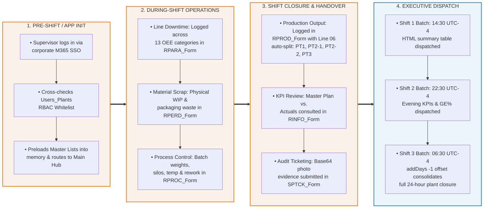
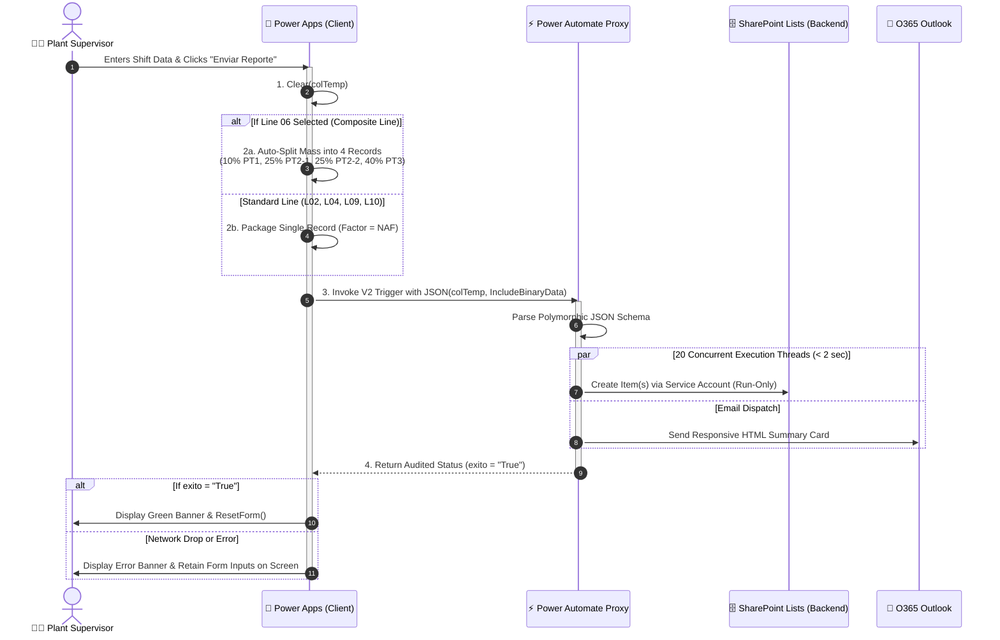

# 📊 Visual Architecture & Operational Workflow Diagrams

This document contains the visual engineering diagrams for the **Shop-Floor Manufacturing Execution & Shift Reporting System**, rendered natively via Mermaid.js.

---

## 1. Legacy "As-Is" Process (Manual Paper & Unlinked Excel)
*Illustrates the legacy operational bottlenecks prior to digital transformation (40–60 minutes lost per shift handover and high risk of formula tampering).*

---

## 2. "To-Be" End-to-End Proxy Architecture Diagram
*Illustrates the Zero-Trust Proxy Security Model where shop-floor tablets maintain strictly Read-Only permissions, delegating all elevated writes to high-concurrency Power Automate service account flows.*

```mermaid
flowchart LR
    User([👨‍🏭 Plant Supervisor / Tablet<br/>M365 SSO Authenticated])
    SPMaster[(📚 SharePoint Online<br/>7 Master & RBAC Lists<br/>Read-Only Lookups)]
    App[📱 Power Apps Canvas App<br/>16:9 Shop-Floor UI<br/>App.Formulas Cache]
    Flows[⚡ Power Automate Proxy Flows<br/>5 Tx Flows: 20 Parallel Threads<br/>3 OData Query Flows]
    SPTx[(🗄️ SharePoint Online<br/>5 Transactional Lists<br/>Elevated Service Account Writes)]
    Batch[⏱️ Scheduled Batch Flows<br/>Shift Closure Dispatchers<br/>06:30 / 14:30 / 22:30 UTC-4]
    Outlook([📧 Office 365 Outlook<br/>Responsive HTML Cards &<br/>24h Executive Summaries])

    User -->|Launches App| App
    SPMaster -.->|Direct Read-Only<br/>Session Cache| App
    App -->|Serialized JSON Payload<br/>+ Base64 Media| Flows
    Flows -->|Execution Status<br/>exito = True| App
    Flows -->|Elevated Write<br/>Run-Only Service Account| SPTx
    SPTx -->|OData Aggregation| Batch
    Flows -->|Real-Time Shift &<br/>Priority MTTO Alerts| Outlook
    Batch -->|Automated Shift-End<br/>Closure Tables| Outlook

    style User fill:#2e5a27,stroke:#1b3817,color:#fff,stroke-width:2px
    style SPMaster fill:#eaecee,stroke:#7f8c8d,color:#333,stroke-width:2px
    style App fill:#f5cba7,stroke:#e67e22,color:#333,stroke-width:2px
    style Flows fill:#a9cce3,stroke:#2980b9,color:#111,stroke-width:2px
    style SPTx fill:#eaecee,stroke:#7f8c8d,color:#333,stroke-width:2px
    style Batch fill:#d2b4de,stroke:#8e44ad,color:#111,stroke-width:2px
    style Outlook fill:#7b241c,stroke:#4a120d,color:#fff,stroke-width:2px
```

---

## 3. Shift Operational Lifecycle (4-Stage Shop-Floor Workflow)
*Outlines the step-by-step operational lifecycle executed during every 8-hour manufacturing shift.*

---

## 4. Audited 4-Step Submission & Composite Split Sequence
*Technical sequence diagram detailing how the frontend handles Composite Line 06 splitting, Base64 conversion, and transactional state retention.*

