# 📊 Enterprise Power BI Semantic Model (Golden Dataset) & 8 Live-Connected Reports


-success?style=for-the-badge)


> **Confidentiality & IP Disclaimer:** *This documentation represents the sanitized Tabular Model Definition Language (TMDL), Power Query (M), and DAX engineering baseline of the centralized Manufacturing Execution System (MES) analytical model. All corporate SharePoint URLs, list GUIDs, and proprietary product brand names have been abstracted.*

---

## 📖 Table of Contents
1. [Hub-and-Spoke Lineage Architecture](#-1-hub-and-spoke-lineage-architecture)
2. [Relational Star & Bridge Schema (20 Tables)](#-2-relational-star--bridge-schema-20-tables)
3. [Advanced DAX Engineering Highlights](#-3-advanced-dax-engineering-highlights)
   * [3.1 23-Step Time Loss Waterfall & Dynamic Pareto Engine](#31-23-step-time-loss-waterfall--dynamic-pareto-engine)
   * [3.2 Look-Behind / Look-Ahead Shift Transition Logic (`H12` & `H27`)](#32-look-behind--look-ahead-shift-transition-logic-h12--h27)
   * [3.3 Dynamic Regular vs. Overtime Shift Classifier (`Tipo Horario`)](#33-dynamic-regular-vs-overtime-shift-classifier-tipo-horario)
   * [3.4 Full Outer Bridge Table for C2S (`Plan Produccion Real`)](#34-full-outer-bridge-table-for-c2s-plan-produccion-real)
   * [3.5 Dynamic Financial Period/Quarter/Half-Year Axis (`Malla-PQH`)](#35-dynamic-financial-periodquarterhalf-year-axis-malla-pqh)
   * [3.6 Statistical Effective Capacity & Nexus Engine (`STDEVX.S`, `MEDIANX`)](#36-statistical-effective-capacity--nexus-engine-stdevxs-medianx)
4. [The Connected Report Ecosystem](#-4-the-connected-report-ecosystem)

---

## 🏗️ 1. Hub-and-Spoke Lineage Architecture

To guarantee a **Single Version of the Truth (SVOT)** across Plant Operations, Continuous Improvement (CI), Maintenance, and Finance/Controllership, the analytical layer was decoupled into a single **Centralized Semantic Model (`RDT_Semantic_Model`)** feeding **1 base workbench report + 8 specialized thin reports** via Live Connection:

```mermaid
flowchart LR
    subgraph Source [Data Layer]
        SP[(🗄️ SharePoint Online<br/>5 Transactional Lists<br/>7 Master Excel/Lists)]
    end

    subgraph Hub [Semantic Layer - Import Mode]
        Model[[🧠 RDT Semantic Model<br/>20 Tables | 25 Relationships<br/>170+ DAX Measures & Calc Columns]]
    end

    subgraph Spokes [Presentation Layer - Live Connection Thin Reports]
        W0[🛠️ RDT Workbench Model<br/><i>Base Engineering Report</i>]
        R1[📋 1. Informe DMS<br/><i>Daily Management System +1d</i>]
        R2[⏱️ 2. Resumen de Turno<br/><i>Shift Handover KPIs</i>]
        R3[📅 3. Cierre Semanal<br/><i>Weekly WoW & C2S Review</i>]
        R4[📉 4. Waterfall y Paradas<br/><i>23-Step OEE/GE & Pareto</i>]
        R5[⚡ 5. Volumen en Sobretiempo<br/><i>Regular vs. OT Shift Analysis</i>]
        R6[⚙️ 6. Capacidad y Desempeño<br/><i>Demonstrated vs. Effective Cap</i>]
        R7[📊 7. Cierre Mensual<br/><i>Period-over-Period PoP</i>]
        R8[🎯 8. Informe Estratégico Anual<br/><i>Dynamic PQH & YTD Executive</i>]
    end

    SP -->|Power Query M<br/>OData v2.0| Model
    Model -.-> W0
    Model ==> R1 & R2 & R3 & R4 & R5 & R6 & R7 & R8

    style Source fill:#eaecee,stroke:#7f8c8d,stroke-width:2px,color:#333
    style Hub fill:#fef9e7,stroke:#f39c12,stroke-width:2px,color:#333
    style Spokes fill:#ebf5fb,stroke:#2980b9,stroke-width:2px,color:#333
```

---

## 🌟 2. Relational Star & Bridge Schema (20 Tables)

The tabular model (`culture: es-MX`) is composed of **3 Fact Tables**, **9 Master/Conformed Dimension Tables**, **4 Disconnected UI/Axis Matrices (`DATATABLE`)**, and **5 Dedicated Measure Groups**:

```mermaid
erDiagram
    MasterData_Lineas ||--o{ Fact_Reportes_Produccion : "Linea (1:*)"
    MasterData_Lineas ||--o{ Fact_Reportes_Paradas : "Linea (1:*)"
    MasterData_Lineas ||--o{ Fact_Reportes_Perdidas : "Linea (1:*)"
    MasterData_Lineas ||--o{ Dim_Plan_Produccion : "Linea (1:*)"
    MasterData_Lineas ||--o{ Dim_Targets_AC : "Linea (1:*)"
    MasterData_Lineas ||--o{ MasterData_Zonas_Equipos : "Linea (1:*)"
    MasterData_Lineas ||--o{ MasterData_Factores : "Linea (1:*)"
    MasterData_Lineas ||--o{ Dim_SKU : "Linea (1:*)"
    MasterData_Lineas ||--o{ Dim_Masas_Cremas : "Linea (1:*)"

    Malla_Calendario ||--o{ Fact_Reportes_Produccion : "Date (1:*)"
    Malla_Calendario ||--o{ Fact_Reportes_Paradas : "Date (1:*)"
    Malla_Calendario ||--o{ Fact_Reportes_Perdidas : "Date (1:*)"
    Malla_Calendario ||--o{ Dim_Plan_Produccion : "Date (1:*)"
    Malla_Calendario ||--o{ Malla_Turnos : "Date (1:*)"
    Malla_Calendario }o--o{ Bridge_Plan_Produccion_Real : "Semana (*:*)"

    MasterData_Turnos ||--o{ Fact_Reportes_Produccion : "Turno (1:*)"
    MasterData_Turnos ||--o{ Fact_Reportes_Paradas : "Turno (1:*)"
    MasterData_Turnos ||--o{ Fact_Reportes_Perdidas : "Turno (1:*)"
    MasterData_Turnos ||--o{ Dim_Plan_Produccion : "Turno (1:*)"

    Bridge_Plan_Produccion_Real ||--o{ Fact_Reportes_Produccion : "UID-PlanProduccion (1:*)"
    Bridge_Plan_Produccion_Real ||--o{ Dim_Plan_Produccion : "UID-PlanProduccion (1:*)"

    Malla_Segmento_Turnos ||--o{ Fact_Reportes_Produccion : "Segmento Turno Detalle (1:*)"
```



### Table Inventory by Role
| Category | Table Name | Storage / Source | Engineering Purpose |
| :--- | :--- | :--- | :--- |
| **Fact Tables** | `BQ-Reportes-Produccion` | Import (SharePoint List) | Shift production outputs, mass balance (`Masas, Cremas, Sal, Aceite, Cobertura, Granel, OW`), and line run hours (`H12..H36`). |
| | `BQ-Reportes-Paradas` | Import (SharePoint List) | Line and equipment downtime logs (`TPE`, `TPL`, `TTP`) across 13 TPM categories. |
| | `BQ-Reportes-Perdidas` | Import (SharePoint List) | Physical material scrap & waste incidents by line zone, machine, cause, and effect. |
| **Bridge / Plan** | `Values-BQ: Plan Produccion` | Import (SharePoint List) | Theoretical shift-level scheduled production targets (`Volumen-P`, `Horas-P`). |
| | `Values-BQ: Plan Produccion Real`| Calculated (`UNION/DISTINCT`)| Full outer bridge table combining planned SKUs and unscheduled produced SKUs by `UID-PlanProduccion`. |
| | `Values-BQ: AC` | Import (SharePoint List) | Quarterly Annual Commitment targets (`Target YIELD`, `Target GE`, `Target VOL`) per line and `Total Planta`. |
| **Dimensions** | `BQ-Malla-Calendario` | Calculated (`CALENDAR`) | Master date dimension (`2020–2029`) with Operational Weeks (`W01..W52`), Periods (`P01..P12`), Quarters, Semesters, and DMS `+1 Day` offset. |
| | `BQ-Malla-Turnos` | Calculated (`CROSSJOIN`) | Cartesian grid of `Calendar Dates × Active Lines × 3 Shifts` to compute theoretical maximum hours (`Tiempo Máximo`). |
| | `MasterData-BQ: Lineas` | Import (SharePoint Excel) | Manufacturing lines (`Linea 02, 04, 06, 09, 10`) and engineering project codes. |
| | `MasterData-BQ: Turnos` | Import (SharePoint Excel) | Shift catalog and nominal shift hours (`Turno 1, 2, 3`). |
| | `MasterData-BQ: Factores` | Import (SharePoint Excel) | Composite line occupation weights (`OcupationLine`, `FactorTier` for `PT1, PT2-1, PT2-2, PT3`). |
| | `MasterData-BQ: Zonas y Equipos`| Import (SharePoint Excel) | Asset hierarchy (`Line -> Area -> Equipment`) with machine reduction factor (`FactorR`). |
| | `Values-BQ: SKU` | Import (SharePoint List) | Product master (`PesoSobre`, `SOBXPAQ`, `PesoPaquete`, `PAQXCCC`, `PesoCaja`). Merged into Production via Power Query `LeftOuter` join. |
| | `Values-BQ: Velocidades de Linea`| Import (SharePoint List) | Nominal speeds (`CapWaterfall`, `CapLineModel`, `CapPlanning`) and standard changeover times (`Pre-Arranque`, `Inicio-Pro`, `Fin-Prod`). |
| | `Values-BQ: Masas y Cremas` | Import (SharePoint List) | Formulation weights (`PesoBatch`, `Reduccion`, `PesoSal`, `PesoSAT`). |
| **UI Matrices** | `BQ-Malla-Waterfall` | Calculated (`DATATABLE`) | 23-row hierarchical structure driving the OEE/GE Waterfall chart and dynamic Pareto. |
| | `BQ-Malla-PQH` | Calculated (`DATATABLE`) | 19-row custom axis (`P01..P12, Q1..Q4, H1..H2, FY`) for executive financial horizon switching. |
| | `BQ-Malla-Segmento-Turnos` | Calculated (`DATATABLE`) | 11-row sorting matrix for Regular (`LAB`) vs. Overtime (`OT`) shift segments. |
| | `BQ-Slicer-Graficas` | Calculated (`SUMMARIZE`) | Disconnected calendar helper table for rolling 2-month trend window filtering (`Filter-Semana`). |

---

## 💻 3. Advanced DAX Engineering Highlights

### 3.1 23-Step Time Loss Waterfall & Dynamic Pareto Engine
To visualize how **Theoretical Calendar Time (`Tiempo Máximo`)** erodes into **Net Good Production Time (`WXFGT`)**, a custom 23-step `DATATABLE` (`BQ-Malla-Waterfall`) was paired with an invisible floating base measure (`WF - Base Invisible`) and a dynamic Pareto cumulative percentage measure:

```dax
// =========================================================================
// FLOATING BASE MEASURE FOR CUSTOM STACKED WATERFALL VISUALIZATION
// =========================================================================
WF - Base Invisible = 
VAR vKey = SELECTEDVALUE('BQ-Malla-Waterfall'[DAX-L3])
VAR vTipo = SELECTEDVALUE('BQ-Malla-Waterfall'[Tipo])
RETURN
IF (
    vTipo = "Pérdida",
    SWITCH(
        vKey,
        -- Block 1: Deducted from Maximum Calendar Time (LNO, No Demand, Force Majeure)
        "WH11", [Tiempo Máximo] - [WH11],
        "WH12", [Tiempo Máximo] - [WH11] - [WH12],
        "WH13", [Tiempo Disponible],
        
        -- Block 2: Deducted from Available Time (7 Planned Downtime Categories)
        "WH21", [Tiempo Disponible] - [WH21],
        "WH22", [Tiempo Disponible] - [WH21] - [WH22],
        "WH23", [Tiempo Disponible] - [WH21] - [WH22] - [WH23],
        "WH24", [Tiempo Disponible] - [WH21] - [WH22] - [WH23] - [WH24],
        "WH25", [Tiempo Disponible] - [WH21] - [WH22] - [WH23] - [WH24] - [WH25],
        "WH26", [Tiempo Disponible] - [WH21] - [WH22] - [WH23] - [WH24] - [WH25] - [WH26],
        "WH27", [Tiempo Productivo],
        
        -- Block 3: Deducted from Productive Time (6 Unplanned Downtime Categories)
        "WH31", [Tiempo Productivo] - [WH31],
        "WH32", [Tiempo Productivo] - [WH31] - [WH32],
        "WH33", [Tiempo Productivo] - [WH31] - [WH32] - [WH33],
        "WH34", [Tiempo Productivo] - [WH31] - [WH32] - [WH33] - [WH34],
        "WH35", [Tiempo Productivo] - [WH31] - [WH32] - [WH33] - [WH34] - [WH35],
        "WH36", [Tiempo Operativo],
        
        -- Block 4: Speed Loss (WXSL) & Quality/Scrap Loss (WXQL)
        "WXSL", [Tiempo Operativo] - [WXSL],
        "WXQL", [WXFGT],
        BLANK()
    ),
    BLANK()
)

// =========================================================================
// DYNAMIC 80/20 PARETO CUMULATIVE PERCENTAGE ACROSS LOSS CATEGORIES
// =========================================================================
Pareto - % Acumulado = 
VAR vValorActual = [Pareto - Horas Pérdida]
VAR vOrdenActual = SELECTEDVALUE('BQ-Malla-Waterfall'[Orden])

VAR vTablaPerdidas = 
    ADDCOLUMNS(
        FILTER(
            ALLSELECTED('BQ-Malla-Waterfall'),
            'BQ-Malla-Waterfall'[Tipo] = "Pérdida" &&
            'BQ-Malla-Waterfall'[Orden] > 5
        ),
        "@Horas", [WF - Perdidas]
    )

VAR vTotalPerdidas = SUMX(FILTER(vTablaPerdidas, [@Horas] > 0), [@Horas])

VAR vHorasAcumuladas = 
    SUMX(
        FILTER(
            vTablaPerdidas,
            [@Horas] > 0 && (
                [@Horas] > vValorActual || 
                ([@Horas] = vValorActual && 'BQ-Malla-Waterfall'[Orden] <= vOrdenActual)
            )
        ),
        [@Horas]
    )

RETURN
IF (
    NOT ISBLANK(vValorActual) && vValorActual > 0,
    DIVIDE( vHorasAcumuladas, vTotalPerdidas, 0 ),
    BLANK()
)
```

---

### 3.2 Look-Behind / Look-Ahead Shift Transition Logic (`H12` & `H27`)
In continuous manufacturing, startup (`Pre-Arranque` / `Inicio-Pro`) and shutdown (`Fin-Prod`) time allowances only apply when a line transitions from an idle state (`0 KG` in the previous shift) or shuts down prior to an idle shift/weekend. This calculated column inspects adjacent shifts chronologically across the entire table:

```dax
// =========================================================================
// AUTOMATED STARTUP / SHUTDOWN TIME ALLOCATION (LOOK-BEHIND & LOOK-AHEAD)
// =========================================================================
FH27 = 
VAR vTotalKGActual = 
    COALESCE('BQ-Reportes-Produccion'[KG Totales Empacados], 0) + 
    COALESCE('BQ-Reportes-Produccion'[KG Totales a Granel], 0) + 
    COALESCE('BQ-Reportes-Produccion'[KG Totales a Producir], 0)
VAR vTieneProduccionFila = (vTotalKGActual > 0)

VAR vFecha = INT('BQ-Reportes-Produccion'[Fecha])
VAR vTurno = TRIM('BQ-Reportes-Produccion'[Turno])
VAR vLinea = TRIM('BQ-Reportes-Produccion'[Linea])
VAR vSKP   = 'BQ-Reportes-Produccion'[SKP]
VAR vDiaSemana = WEEKDAY(vFecha, 2)

-- Identify chronological Previous Shift and Next Shift (handling overnight date boundaries)
VAR vTurnoPrevio = SWITCH(vTurno, "Turno 1", "Turno 3", "Turno 2", "Turno 1", "Turno 3", "Turno 2")
VAR vFechaPrevia = IF(vTurno = "Turno 1", vFecha - 1, vFecha)

VAR vTurnoSiguiente = SWITCH(vTurno, "Turno 1", "Turno 2", "Turno 2", "Turno 3", "Turno 3", "Turno 1")
VAR vFechaSiguiente = IF(vTurno = "Turno 3", vFecha + 1, vFecha)

VAR vEsInicioFinDeSemana = ( vTurno = "Turno 1" && (vDiaSemana IN {1, 6, 7}) )
VAR vEsFinFinDeSemana    = ( vTurno = "Turno 3" && (vDiaSemana IN {5, 6, 7}) )

-- Query previous shift activity
VAR vConteoProduccionPrevia = 
    CALCULATE(
        COUNTROWS('BQ-Reportes-Produccion'),
        ALL('BQ-Reportes-Produccion'),
        INT('BQ-Reportes-Produccion'[Fecha]) = vFechaPrevia,
        TRIM('BQ-Reportes-Produccion'[Turno]) = vTurnoPrevio,
        TRIM('BQ-Reportes-Produccion'[Linea]) = vLinea,
        (COALESCE('BQ-Reportes-Produccion'[KG Totales Empacados], 0) + 
         COALESCE('BQ-Reportes-Produccion'[KG Totales a Granel], 0) + 
         COALESCE('BQ-Reportes-Produccion'[KG Totales a Producir], 0)) > 0
    )

-- Query next shift activity
VAR vConteoProduccionSiguiente = 
    CALCULATE(
        COUNTROWS('BQ-Reportes-Produccion'),
        ALL('BQ-Reportes-Produccion'),
        INT('BQ-Reportes-Produccion'[Fecha]) = vFechaSiguiente,
        TRIM('BQ-Reportes-Produccion'[Turno]) = vTurnoSiguiente,
        TRIM('BQ-Reportes-Produccion'[Linea]) = vLinea,
        (COALESCE('BQ-Reportes-Produccion'[KG Totales Empacados], 0) + 
         COALESCE('BQ-Reportes-Produccion'[KG Totales a Granel], 0) + 
         COALESCE('BQ-Reportes-Produccion'[KG Totales a Producir], 0)) > 0
    )

VAR vEsInicio = (COALESCE(vConteoProduccionPrevia, 0) = 0) || vEsInicioFinDeSemana
VAR vEsFin    = (COALESCE(vConteoProduccionSiguiente, 0) = 0) || vEsFinFinDeSemana

VAR vPreArranque = CALCULATE(MAX('Values-BQ: Velocidades de Linea'[Pre-Arranque]), 'Values-BQ: Velocidades de Linea'[SKP] = vSKP)
VAR vInicioP     = CALCULATE(MAX('Values-BQ: Velocidades de Linea'[Incio-Pro]), 'Values-BQ: Velocidades de Linea'[SKP] = vSKP)
VAR vFinalP      = CALCULATE(MAX('Values-BQ: Velocidades de Linea'[Fin-Prod]), 'Values-BQ: Velocidades de Linea'[SKP] = vSKP)

VAR vHorasTotales = 
    ( IF(vEsInicio, COALESCE(vPreArranque, 0) + COALESCE(vInicioP, 0), 0) + 
      IF(vEsFin, COALESCE(vFinalP, 0), 0) ) / 60

VAR vFactorL = LOOKUPVALUE('MasterData-BQ: Factores'[OcupationLine], 'MasterData-BQ: Factores'[FactorTier], 'BQ-Reportes-Produccion'[FactorTier])

RETURN 
IF ( NOT vTieneProduccionFila, 0, (vHorasTotales * vFactorL) ) + 0
```

---

### 3.3 Dynamic Regular vs. Overtime Shift Classifier (`Tipo Horario`)
Instead of hardcoding shift schedules, the model inspects how many active shifts a line ran on **Thursday (`WEEKDAY = 4`)** of that specific week to infer the baseline crewing pattern (1, 2, or 3 shifts), automatically classifying Friday sanitation cutoffs and weekend runs into `"Horario Laboral"` vs `"Sobretiempo"`:

```dax
Tipo Horario = 
VAR _TurnoTexto = 'BQ-Reportes-Produccion'[Turno]
VAR _NumTurno = 
    SWITCH(
        TRUE(),
        CONTAINSSTRING(_TurnoTexto, "1"), 1,
        CONTAINSSTRING(_TurnoTexto, "2"), 2,
        CONTAINSSTRING(_TurnoTexto, "3"), 3,
        1
    )
VAR _Fecha = RELATED('BQ-Malla-Calendario'[Date])
VAR _DiaSemana = WEEKDAY(_Fecha, 2)
VAR _LineaActual = 'BQ-Reportes-Produccion'[Linea]
VAR _SemanaActual = RELATED('BQ-Malla-Calendario'[Semana])

-- Benchmark active crewing pattern based on Thursday (Day 4) of the same week/line
VAR _TurnosDelJueves = 
    CALCULATE(
        DISTINCTCOUNT('BQ-Reportes-Produccion'[Turno]),
        FILTER(
            ALL('BQ-Reportes-Produccion'),
            'BQ-Reportes-Produccion'[Linea] = _LineaActual &&
            RELATED('BQ-Malla-Calendario'[Semana]) = _SemanaActual &&
            WEEKDAY(RELATED('BQ-Malla-Calendario'[Date]), 2) = 4
        )
    )
VAR _EsquemaTurnos = COALESCE(_TurnosDelJueves, 3)

RETURN
SWITCH(
    TRUE(),
    _DiaSemana >= 6, "Sobretiempo",
    _DiaSemana <= 4 && _NumTurno <= _EsquemaTurnos, "Horario Laboral",
    _DiaSemana = 5 && _EsquemaTurnos > 1 && _NumTurno <= (_EsquemaTurnos - 1), "Horario Laboral",
    "Sobretiempo"
)
```

---

### 3.4 Full Outer Bridge Table for C2S (`Plan Produccion Real`)
To accurately compute **C2S (Compliance to Schedule)** when a plant manufactures an unscheduled SKU (or fails to run a planned SKU), a DAX bridge table performs a `DISTINCT(UNION(...))` between the Master Plan and Actual Production:

```dax
C2S Semana Real = 
VAR Plan = SUM('Values-BQ: Plan Produccion Real'[Total KG Planificados Semanal])
VAR Real = SUM('Values-BQ: Plan Produccion Real'[Total KG Entregados Semanal])
VAR vPlan = COALESCE(Plan, 0)
VAR vReal = COALESCE(Real, 0)

RETURN
IF(
    vPlan = 0 && vReal = 0, BLANK(),
    IF(
        vPlan = 0, 0, -- Unscheduled production penalizes C2S adherence to 0%
        VAR ErrorRatio = DIVIDE(ABS(vPlan - vReal), vPlan, 0)
        RETURN MAX(0, 1 - ErrorRatio)
    )
)
```

---

### 3.5 Dynamic Financial Period/Quarter/Half-Year Axis (`Malla-PQH`)
Enables executive charts to display monthly periods (`P01..P12`) alongside automatic roll-up bars for Quarters (`Q1..Q4`), Semesters (`H1..H2`), and Full Year (`FY`) on the exact same X-axis, dynamically hiding future periods based on the user's slicer selection (`BQ-Filter-PQH-Dinamico`).

---

### 3.6 Statistical Effective Capacity & Nexus Engine (`STDEVX.S`, `MEDIANX`)
To eliminate distortion from non-operating shifts, the model summarizes production at the `Date × Shift` grain, filters for active runs (`[@TonPorTurno] > 0`), and computes:
* `Volumen Promedio Efectivo (TON)` (`AVERAGEX`)
* `Volumen Mediana Efectivo (TON)` (`MEDIANX`)
* `Volumen Desviacion Estandar Efectiva (TON)` (`STDEVX.S` with `N >= 2` guard)
* `Capacidad Demostrada` vs `Capacidad Efectiva` (`GE Demostrado` median multiplier)

---

## 📑 4. The Connected Report Ecosystem

As shown in the Power BI Service lineage view, **1 base workbench report** and **8 end-user analytical reports** connect live to this single semantic model:

| # | Report Name (Service Lineage) | Target Audience | Primary Analytical Scope & Key Measures |
| :- | :--- | :--- | :--- |
| **00** | **`RDT BQ` *(Workbench Model)*** | BI Architect / Admin | Master development canvas and measure validation sandbox. |
| **01** | **`Informe DMS`** | Daily Management System | Daily operational review using `+1 Day` DMS offset (`DiaDMS`), tracking yesterday's closure KPIs (`YIELD`, `GE`, `TON Empacadas`). |
| **02** | **`Resumen de Turno`** | Shift Supervisors & Leads | Granular shift-by-shift performance (`Resumen-T`), mass balance (`Masas, Cremas, Sal, Aceite, Granel, OW`), and SKU adherence. |
| **03** | **`Cierre Semanal`** | Plant Operations & Planning | Week-over-Week (`Semana Actual` vs `Anterior`) volume, `C2S Semana Real`, `Total KG por Entregar`, and rolling 2-month trend (`Filter-Semana`). |
| **04** | **`Waterfall y Paradas`** | Continuous Improvement (CI) | 23-step time loss Waterfall (`Tiempo Máximo` -> `WXFGT`), `% LU`, `% AU`, `% OEE`, `% GE`, and 80/20 Downtime Pareto (`Pareto - % Acumulado`). |
| **05** | **`Volumen en Sobretiempo`** | Operations & HR / Labor Cost | Analyzes production volume split between Regular Crewing (`Horario Laboral`) and Overtime (`Sobretiempo %`) across 11 shift segments (`T1 LUN` to `DOM T1 OT`). |
| **06** | **`Informe de Capacidad y Desempeño`**| Industrial Engineering (Nexus)| Evaluates `Capacidad Demostrada` vs `Capacidad Efectiva`, `Brecha Capacidad`, `GE Demostrado` (`MEDIANX`), and shift tonnage dispersion (`STDEVX.S`). |
| **07** | **`Cierre Mensual`** | Plant Management & Finance | Period-over-Period (`PoP Actual` vs `PoP Anterior`) tonnage, schedule adherence, and dynamic quarterly target comparisons (`Values-BQ: AC`). |
| **08** | **`Informe Estratégico Anual`** | Executive Leadership (ISC) | Multi-horizon financial/operational view (`BQ-Malla-PQH`) displaying `P01..P12`, `Q1..Q4`, `H1..H2`, `FY`, and `YTD` cumulative targets. |

---
*Architected and modeled by **Tairo Bonilla** — BI & Low-Code Solutions Architect.*
